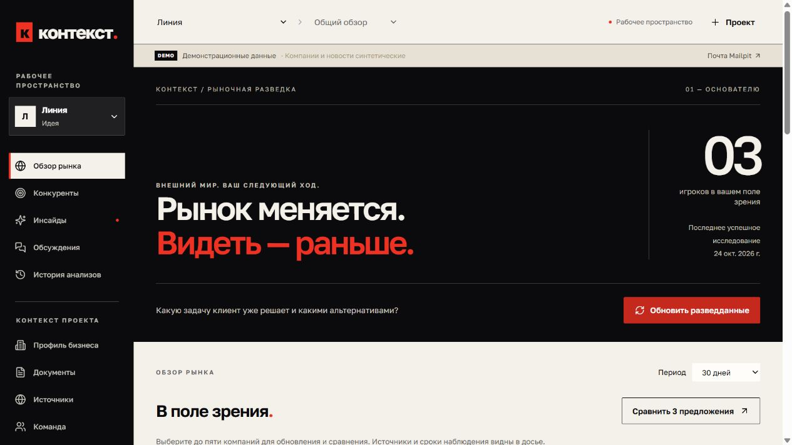
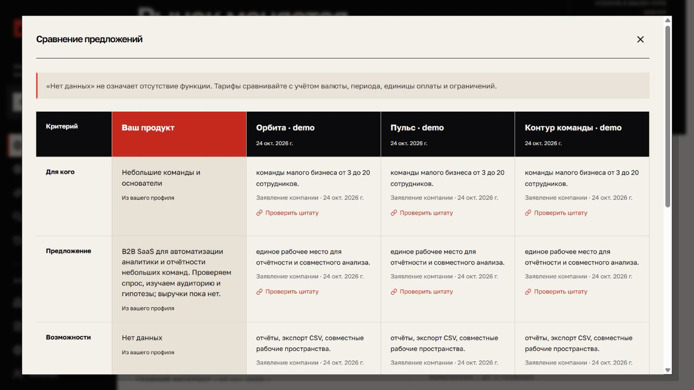
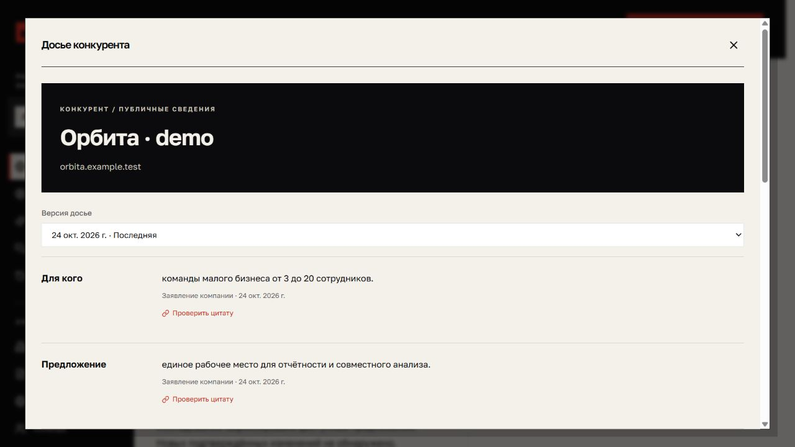
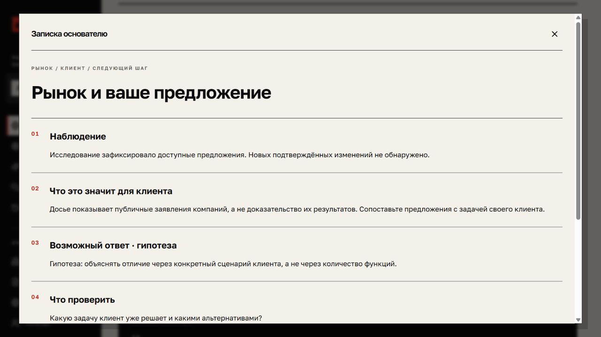
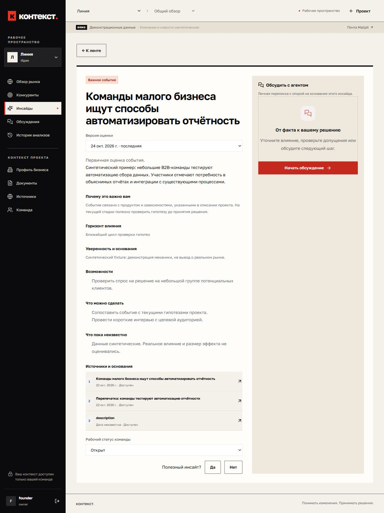
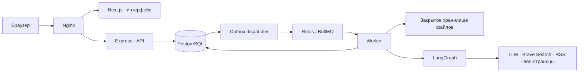

<div align="center">

# Контекст

### Рыночная разведка для основателя

От новостей и страниц конкурентов — к выводам о вашем бизнесе и гипотезам для проверки.


[Возможности](#возможности) · [Архитектура](#архитектура) · [Быстрый старт](#быстрый-старт) · [Документация](#документация)

</div>

---

## О проекте

**Контекст** — веб-приложение для исследования рынка с учётом конкретного бизнеса. Оно объединяет профиль компании, внутренние документы, публичные источники и данные о конкурентах в одном рабочем пространстве.

Основателю небольшой команды приходится самостоятельно разбираться, какие новости влияют на продукт, чем отличаются предложения конкурентов и какие предположения стоит проверить в продажах. «Контекст» помогает пройти этот путь: собрать материалы, увидеть изменения, проверить основания вывода и сохранить принятое решение.

Проект рассчитан на разные стадии бизнеса — от идеи и проверки спроса до первых продаж и роста. Интерфейс и аналитические материалы — на русском языке. Для знакомства предусмотрен **demo-режим без API-ключей**, для работы с реальными источниками — отдельный live-режим.

## Возможности

| Раздел | Что можно сделать |
| --- | --- |
| **Обзор рынка** | Запустить исследование, увидеть изменения, гипотезы возможностей, пробелы в данных и историю запусков. |
| **Конкуренты** | Найти и подтвердить компании, открыть досье, закрепить до пяти страниц для наблюдения за каждым конкурентом. |
| **Сравнение предложений** | Сопоставить от двух до пяти конкурентов со своим продуктом по аудитории, возможностям, тарифам и интеграциям. |
| **Изменения и источники** | Проверить цитату, дату наблюдения и сохранённый снимок страницы; увидеть изменение тарифа в формате «было → стало». |
| **Инсайды** | Получить ленту событий с объяснением их значения для бизнеса, основаниями и статусом проверки. |
| **Документы и профиль** | Загрузить PDF, DOCX, PPTX, TXT или Markdown; получить предложения по заполнению профиля и подтвердить их вручную. |
| **Обсуждения и решения** | Обсудить инсайт с AI, вести приватный или общий чат, сохранить решение по аналитической записке и экспортировать её в Markdown. |
| **Командная работа** | Пригласить участников, назначить роли и ограничить доступ отдельными направлениями бизнеса. |

Факты, заявления компаний, гипотезы и ручные уточнения различаются явно. Отсутствующие сведения обозначаются как «Нет данных», а пользовательские уточнения сохраняются при повторном исследовании.

### Как выглядит работа с проектом

1. **Описать бизнес.** Для создания проекта достаточно названия, стадии и описания. Аудиторию, географию, монетизацию и текущий вопрос можно уточнить позже.
2. **Добавить контекст.** Загрузить документы, проверить предложенные сведения и выбрать конкурентов.
3. **Запустить исследование.** Приложение соберёт источники, извлечёт утверждения, сравнит наблюдения и подготовит записку.
4. **Проверить основания.** Из сравнения или досье можно открыть цитату и снимок, на котором основан факт.
5. **Выбрать следующий шаг.** Обсудить вывод, сохранить решение и вернуться к нему при следующем исследовании.

Результат исследования организован по схеме **«наблюдение → значение → ответ → проверка»**: что произошло, почему это относится к бизнесу, как можно отреагировать и что проверить на практике.

### Интерфейс

Визуальный стиль — тёмная журнальная сетка, светлые поверхности для чтения, красные акценты и локальный шрифт Golos Text. Интерфейс адаптируется к настольным и мобильным экранам; таблица сравнения на телефоне сохраняет собственный продукт и позволяет переключать конкурентов. Выбранный раздел, направление, фильтры и открытый материал сохраняются в URL, а необязательная анимация учитывает системную настройку reduced motion.

Личная версия «Контекста»: от обзора рынка и конкурентов — к объяснению новости и следующему решению. Снимки сделаны 14 ноября 2026 года в работающем приложении на синтетическом проекте «Линия». Демонстрационные компании, новости и цены вымышлены; личные данные и переписки в галерею не включены.

**Обзор рынка.** Рабочее пространство основателя с быстрым входом в исследование и наблюдением за конкурентами.



**Сравнение предложений.** Собственный продукт рядом с конкурентами; аудитория, возможности и проверяемые цитаты в одной таблице.



| Досье конкурента | Записка основателю |
| --- | --- |
| Публичные сведения, версии и источники каждого утверждения. | Наблюдение → значение для клиента → гипотеза ответа → проверка. |
| [](docs/assets/portfolio/03-competitor-dossier.jpg) | [](docs/assets/portfolio/04-founder-brief.jpg) |

<details>
<summary><strong>Разбор новости: влияние, возможности, следующие шаги и основания</strong></summary>

Отдельная страница инсайда связывает событие с контекстом бизнеса. Видны версия оценки, неопределённость, источники и вход в обсуждение с агентом.



</details>

[Все снимки в исходном разрешении](docs/assets/portfolio/README.md).

## Стек

| Слой | Технологии |
| --- | --- |
| **Frontend** | Next.js 16, React 19, TypeScript, TanStack Query, Tailwind CSS 4, Radix UI, Lucide |
| **API и контракты** | Express 5, Zod, OpenAPI |
| **Данные** | PostgreSQL 17, Prisma 7, полнотекстовый поиск RU/EN и `pg_trgm` |
| **AI и источники** | LangGraph JS, PostgreSQL checkpoints, Gemini / OpenAI-совместимый HTTP-адаптер, Brave Search, RSS |
| **Фоновые задачи** | Redis 7, BullMQ, transactional outbox |
| **Инфраструктура** | pnpm workspaces, Docker Compose, Nginx, Mailpit |
| **Проверки** | Vitest, Supertest, Playwright, синтетические наборы оценки |

## Архитектура

Приложение разделено на три процесса: веб-интерфейс, API и worker. API обслуживает запросы и создаёт задания, а извлечение документов и аналитические графы выполняются в фоне.



Граф рыночного исследования проходит этапы:

```text
Контекст → План → Сбор источников → Извлечение фактов
         → Сравнение → Проверка → Записка → Сохранение
```

### Ключевые технические решения

- **Проверяемые основания.** Факты связаны с неизменяемыми снимками источников. Цитата проверяется по тексту снимка, структурированный ответ модели проходит Zod-валидацию. Это позволяет проверить происхождение утверждения; достоверность самого источника требует отдельной оценки.
- **Восстановление фоновой работы.** Создание запуска и запись в outbox выполняются одной транзакцией. Состояние графа хранится в PostgreSQL; повторная доставка задания защищена от повторной публикации результата.
- **Контекст из документов.** Текст разбивается на фрагменты с указанием страницы, слайда или другого положения в документе. Поиск использует PostgreSQL FTS и trigram-сходство. Удалённые источники исключаются из новых ответов.
- **Контроль ресурсов.** Для исследования и чата заданы отдельные лимиты запросов, страниц, LLM-вызовов и токенов. Исследование ограничено по времени, поддерживает отмену и частичный результат.
- **Разграничение доступа.** Сервер проверяет роль и доступ к направлению, в том числе при выполнении фоновых задач. Пароли хешируются Argon2id; предусмотрены серверные сессии, CSRF- и Origin-проверки.
- **Обновление интерфейса.** Прогресс передаётся через SSE с восстановлением событий; при обрыве соединения временно включается polling.

Подробности: [архитектура и границы доверия](docs/architecture.md), [модель данных](docs/data-model.md).

## Быстрый старт

Самый короткий путь познакомиться с приложением — запустить demo через Docker. Понадобится Docker Desktop или Docker Engine с Compose v2. Node.js и pnpm на хосте для этого способа не нужны.

**1. Скопируйте конфигурацию** в корне репозитория:

```sh
cp .env.example .env
```

Если `.env` уже существует, сохраните свои настройки вместо повторного копирования.

**2. Настройте `.env`:**

- Оставьте `APP_MODE=demo`.
- Задайте `SESSION_SECRET` случайной строкой длиной не менее 32 символов. Например, сгенерируйте её командой `openssl rand -hex 32`.
- Укажите `LLM_CONTEXT_LIMIT=32000` — значение должно содержать только число.

Ключи LLM и Brave Search для demo не требуются. Локальный `.env` исключён из Git.

**3. Запустите приложение:**

```sh
docker compose --profile demo up --build
```

При первом запуске собирается образ, применяются миграции и создаются демонстрационные проекты. Дождитесь готовности сервисов.

| Сервис | Адрес |
| --- | --- |
| Приложение | [localhost:3000](http://localhost:3000) |
| Mailpit — письма регистрации и восстановления пароля | [localhost:8025](http://localhost:8025) |

Нажмите **«Войти в demo»** или используйте демонстрационные аккаунты:

| Аккаунт | Назначение | Пароль |
| --- | --- | --- |
| `founder@example.test` | Владелец демонстрационных проектов | `Context-demo-2026!` |
| `reader@example.test` | Проверка доступа после приглашения в проект | `Context-demo-2026!` |

> В demo используются вымышленные компании, публикации и детерминированные ответы. Этот режим демонстрирует работу приложения; его выводы относятся только к синтетическим данным.

Данные PostgreSQL, Redis и загруженные файлы сохраняются в Docker volumes. Для остановки используйте `docker compose stop`, для повторного запуска — `docker compose --profile demo up -d`.

### Что попробовать после запуска

1. Откройте проект **«Линия»** — пример B2B SaaS. Также доступны «Тихая полка» для товарного бизнеса и «Меридиан» с несколькими направлениями.
2. На обзоре рынка нажмите **«Обновить разведданные»**. Откройте досье конкурента, сравните предложения и проверьте цитату через снимок источника.
3. Откройте аналитическую записку, сохраните решение и скачайте Markdown.
4. Перейдите в **«Инсайды»**, нажмите **«Получить инсайды»**, откройте карточку и начните обсуждение.
5. Загрузите [тестовый документ](tests/fixtures/synthetic.md) в разделе **«Документы»** и подтвердите предложенные сведения в профиле бизнеса.
6. Пригласите `reader@example.test` через раздел **«Команда»** и примите приглашение вторым аккаунтом в другом браузере или приватном окне.

<details>
<summary><strong>Демонстрация изменения тарифа конкурента</strong></summary>

Сначала выполните обычное исследование, чтобы сохранить исходное наблюдение. Затем закрепите у синтетического конкурента страницу `https://demo.example.test/pricing?scenario=updated` и повторите исследование.

Demo-адаптер вернёт изменение **2 900 → 3 900 RUB**. В досье можно проверить обе цитаты и даты наблюдений. URL обрабатывается внутри demo и обозначает вымышленное предложение.

</details>

## Локальная разработка

Требования: **Node.js 22.19.0+**, **pnpm 11.25.0** и работающий Docker. Подготовьте `.env`, как описано в быстром старте. Для запуска процессов на хосте используются адреса из примера: PostgreSQL — `localhost:5433`, Redis — `localhost:6380`, SMTP — `localhost:1025`.

```sh
pnpm install --frozen-lockfile
docker compose -f compose.yaml -f compose.dev.yaml --profile demo up -d postgres redis mailpit
pnpm db:generate
pnpm db:migrate
pnpm db:seed:demo
pnpm dev
```

`pnpm dev` запускает web на порту **3000**, API на **4000** и worker. Next.js проксирует запросы `/api/v1` в API. Если ранее был запущен полный Docker-стек, остановите его перед этим сценарием, чтобы освободить порт 3000.

<details>
<summary><strong>Live-режим и переменные окружения</strong></summary>

В live приложение обращается к реальным внешним сервисам. Для отдельного экземпляра настройте:

| Переменные | Назначение |
| --- | --- |
| `APP_MODE=live` | Работа с реальными адаптерами |
| `LLM_PROVIDER`, `LLM_BASE_URL`, `LLM_MODEL_ID`, `LLM_API_KEY` | Провайдер, endpoint, доступная модель и ключ LLM |
| `BRAVE_SEARCH_API_KEY` | Ключ веб-поиска; RSS не требует ключа |
| `SMTP_*`, `COMPOSE_SMTP_HOST` | Отправка писем; отдельное имя SMTP-хоста внутри контейнеров |
| `SESSION_SECRET`, `POSTGRES_PASSWORD`, `PUBLIC_APP_URL` | Собственные секреты и публичный адрес приложения |
| `RUN_MAX_*`, `CHAT_MAX_*` | Лимиты исследования и чата |
| `LLM_CONTEXT_LIMIT`, `LLM_MAX_OUTPUT_TOKENS` | Контекстное окно и максимальный объём ответа |
| `TOKEN_PRICE_INPUT`, `TOKEN_PRICE_OUTPUT` | Необязательная оценка стоимости в USD за миллион токенов |

Поддерживаются Gemini через совместимый endpoint `https://generativelanguage.googleapis.com/v1beta/openai` и OpenAI-совместимые HTTP-сервисы. Выберите модель, доступную вашему аккаунту, и согласуйте лимиты с её возможностями. Без заданных тарифов стоимость отображается как неизвестная.

Запускайте demo и live с отдельными Compose project names и volumes. После изменения конфигурации пересоздайте API и worker. Для публичного размещения нужны HTTPS и соответствующий `PUBLIC_APP_URL`. Порядок запуска, резервного копирования и восстановления описан в [руководстве по эксплуатации](docs/operations.md).

Приватный профиль и содержимое документов могут передаваться настроенному LLM для анализа. При ошибке live-интеграции сервер возвращает явную ошибку; автоматического перехода к demo-ответам нет.

</details>

## Проверки

| Команда | Назначение |
| --- | --- |
| `pnpm typecheck` | Проверка типов API, пакетов и frontend |
| `pnpm lint` | Статический анализ |
| `pnpm build` | Проверка типов и production-сборка frontend |
| `pnpm test` | Unit-тесты доменной логики, форматов, провайдеров и сетевых ограничений |
| `pnpm test:integration` | Сценарии с настоящими PostgreSQL, Redis и worker |
| `pnpm test:e2e` | Браузерные сценарии на desktop, tablet и mobile |
| `pnpm exec tsx scripts/evaluate.ts` | Регрессия новостного отбора: 16 синтетических случаев |
| `pnpm exec tsx scripts/evaluate-research.ts` | Регрессия исследования: 42 случая для шести стадий бизнеса |
| `node scripts/secret-scan.mjs` | Проверка исходников на секреты и приватные runtime-файлы |

Integration-тестам нужны PostgreSQL с правом `CREATE DATABASE` и Redis. Скрипт создаёт отдельную тестовую БД и удаляет её после проверки. E2E запускаются при работающем demo-приложении и Mailpit; перед первым прогоном установите браузер командой `pnpm exec playwright install chromium`. Адреса можно изменить через `E2E_BASE_URL` и `E2E_MAIL_URL`.

Контрактные тесты используют подменённые внешние сервисы, а синтетические оценки проверяют функциональную регрессию. Качество рекомендаций реальной модели и полнота поиска требуют отдельной оценки. Скрипт `pnpm exec tsx scripts/live-smoke.ts` проверяет подключение LLM и Brave: без ключей пропускается, с ключами выполняет реальные вызовы, которые могут тарифицироваться.

## Структура репозитория

```text
apps/
  web/                 Next.js: интерфейс и маршруты рабочего пространства
  api/                 Express: авторизация, проекты, документы, исследования, чаты
  worker/              Фоновые задания и обработка событий
packages/
  agent/               LangGraph, провайдеры, источники, обработка документов
  contracts/           Zod-схемы, общие типы и OpenAPI
  config/              Валидация конфигурации окружения
  db/                  Prisma, миграции и demo seed
  ui/                  Общие UI-утилиты
docs/                  Архитектура, модель данных, эксплуатация и отчёты
infra/                 Конфигурация Nginx
scripts/               Проверки, оценка качества и служебные сценарии
tests/                 Unit, integration, E2E и синтетические материалы
```

## Границы проекта

- Исследования и получение инсайдов запускаются пользователем. Автоматического анализа по расписанию нет.
- OCR не выполняется: сканированные PDF могут потребовать распознавания вне приложения. Графики и изображения презентаций не интерпретируются.
- Недоступные страницы и пробелы в источниках могут привести к частичному результату. Авторизация и paywall внешних сайтов не обходятся.
- Приложение сохраняет гипотезы и решения пользователя; автономных действий от имени компании, CRM и биллинга нет.

## Документация

| Материал | Содержание |
| --- | --- |
| [Архитектура](docs/architecture.md) | Компоненты, потоки данных и границы доверия |
| [Модель данных](docs/data-model.md) | Сущности, версии, связи и индексы |
| [OpenAPI](docs/openapi.json) | Контракт API; также доступен по `/api/v1/openapi.json` |
| [Эксплуатация](docs/operations.md) | Окружения, диагностика, backup и restore |
| [Состояние реализации](docs/implementation-status.md) | История проверок и известные ограничения |
| [Оценка новостного отбора](docs/evaluation-report.md) | Размеченные синтетические сценарии |
| [Оценка рыночного исследования](docs/research-evaluation.md) | Проверки цитат, изменений и оснований рекомендаций |
| [Сторонние компоненты](THIRD_PARTY_NOTICES.md) | Зависимости и уведомления о лицензиях |
