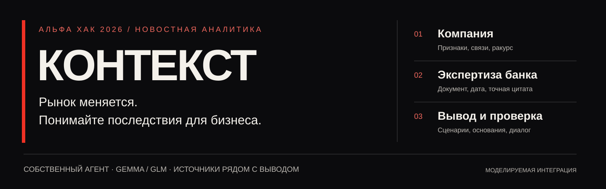
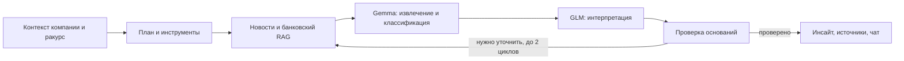
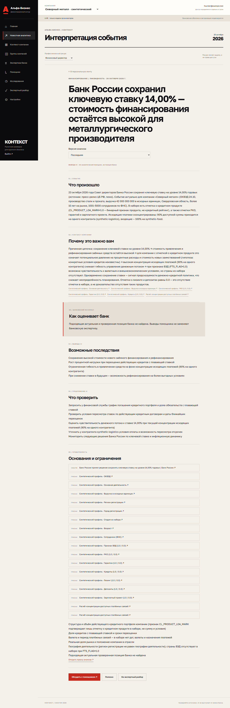
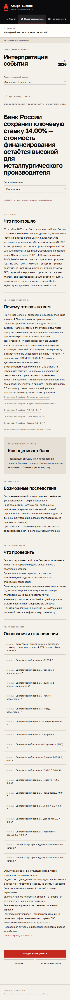

<p align="center"></p>

# Контекст · Альфа Хак 2026

**От новости — к последствиям для конкретного бизнеса.** Персонализированная аналитика для руководителей крупных компаний: внешний факт, контекст клиента, датированная экспертиза банка и проверяемые следующие шаги.

[Начать проверку](docs/hackathon-judge.md) · [Все требования кейса](docs/hackathon-requirements.md) · [Матрица соответствия](docs/hackathon-compliance.md) · [Документация](docs/README.md)

> **Хакатонная ветка:** `hackathon/alfa-2026`. Основа — `main@1f2e1ae`. Авторизация и оболочка интернет-банка моделируются. Банковские операции не выполняются. Финальная независимая смысловая экспертиза пока не завершена.

## Что получает руководитель

| Вопрос                   | Ответ сервиса                                                                          |
| ------------------------ | -------------------------------------------------------------------------------------- |
| Что изменилось?          | Событие и точный исходный фрагмент, дата и первоисточник                               |
| Почему это касается нас? | Подтверждённые признаки компании, платёжные зависимости и пробелы в данных             |
| Как это оценивает банк?  | Цитата из банковского PDF с датой и страницей либо явное отсутствие подходящей позиции |
| Что делать дальше?       | Возможные последствия и конкретные вопросы для проверки; вывод AI маркируется отдельно |

Один анализ события для компании, семь профессиональных ракурсов: собственник, CEO, CFO, главный бухгалтер, казначей, другой C-level, сотрудник. Ракурс меняет приоритеты, **доступ выдаётся отдельно**.

## Быстрый запуск

Нужны **Node.js 22.19+**, **pnpm 11.25.0**, **Docker Engine с Linux-контейнерами и Compose**.

```sh
git clone --branch hackathon/alfa-2026 --single-branch https://github.com/Shibkov-Gleb/Business-insights.git context-alfa
cd context-alfa
pnpm install --frozen-lockfile
pnpm hackathon:up
```

Откройте **[localhost:3010](http://localhost:3010)**. На свежем окружении запускается demo без ключей и платных исследований. Команда создаёт отдельный `.env`, проверяет SHA исходников, выполняет миграции, CSV COPY, локальный OCR и seed. Первая сборка/OCR занимают несколько минут. Если Drive недоступен, разместите оригиналы в `.hackathon/raw` по [manifest](data/hackathon/sources.manifest.json) и повторите запуск.

Кнопка **«Открыть демонстрацию»** доступна в demo. Для live используйте обычный вход в тестовый аккаунт: реквизиты и ограничения — в [сценарии жюри](docs/hackathon-judge.md#test-accounts). Существующий `.env` не перезаписывается: уже настроенный live остаётся live.

| Адрес                                 | Назначение                          |
| ------------------------------------- | ----------------------------------- |
| `http://localhost:3010`               | Приложение и `/api/v1` через Nginx  |
| `http://localhost:8030`               | Mailpit, моделируемая почта         |
| `localhost:15433` / `localhost:16380` | PostgreSQL / Redis, только loopback |

Compose-проект `context-alfa-hackathon` использует собственные БД, файлы, сессии и образ. Порт 3000 и данные личного продукта отделены. [Настройка, переменные и сохранность данных →](docs/hackathon-operations.md)

## Данные и собственный агент

**85 525** строк компаний · **1 380 585** платёжных строк · **9** банковских PDF · **64** страницы корпуса.



Next.js/React · Express · PostgreSQL · Redis/BullMQ · собственный LangGraph. Сохранены outbox, checkpoints, отмена, версии и SSE. Оригиналы CSV/PDF и ключи **не входят в Git**. Три демонстрационные компании и дополнительные события явно синтетические. Рыночная доля и неизвестные единицы денежных полей не выдумываются.

[Архитектура](docs/hackathon-architecture.md) · [Модель и словарь данных](docs/hackathon-data-model.md) · [Источники/OCR](docs/hackathon-sources.md) · [API/OpenAPI](docs/hackathon-api.md) · [Безопасность](docs/hackathon-security.md)

## Demo и live

|             | Demo                                 | Live                                                   |
| ----------- | ------------------------------------ | ------------------------------------------------------ |
| AI          | Детерминированные узлы того же графа | Gemma / GLM через шлюз организаторов                   |
| Новости     | Синтетические события                | RSS ЦБ, URL/текст; Brave при отдельном ключе           |
| Запуск      | Без ключей                           | Только явное действие пользователя                     |
| Бюджет      | Платных вызовов нет                  | Общий лимит до 500 ₽/сутки на ключ, сброс 03:00 МСК    |
| Цена ответа | Не измеряет тариф LLM                | `null`, если тарифы неизвестны; счётчик шлюза отдельно |

Live проверен 25.10.2026. В `gateway` таблица тарифов не требуется: весь остаток резервируется атомарно, перед вызовом проверяется общий счётчик. Личный Gemini не используется как fallback. [Точная конфигурация →](docs/hackathon-configuration.md)

## Результаты и границы

| Проверка                                    | Последний опубликованный результат                                     |
| ------------------------------------------- | ---------------------------------------------------------------------- |
| Unit / integration                          | **82 / 30**, все успешно                                               |
| Браузер                                     | Demo: 6 сценариев; live: три размера экрана и чат с отказом SSE        |
| Typecheck / lint / production build         | Успешно                                                                |
| Первичный live-набор                        | 20/20 обработаны, Precision@5 **0,70**                                 |
| Регрессия live-v2 после исправления словаря | 20/20 успешно, Precision@5 **0,80** при цели 0,80                      |
| Источники                                   | Механическая валидность 100%; формальных нарушений банковских ссылок 0 |
| Сохранность                                 | Контрольные суммы данных и 9 PDF совпали после restart/переключения    |

Повторный набор уже просмотрен при диагностике: **регрессия не является независимой оценкой качества**. Валидная цитата не доказывает смысловую правильность рекомендации. Полнота интернет-поиска, семантическое объединение пересказов и промышленный SLA не заявлены. Финальный тег `alfa-hackathon-v1` пока не создан.

[Приёмка и все доказательства](docs/hackathon-acceptance.md) · [Метрики и процесс экспертизы](docs/hackathon-evaluation.md)

## Проверка кода

```sh
pnpm docs:check
pnpm typecheck
pnpm lint
pnpm test
pnpm test:integration
pnpm hackathon:evaluate
pnpm build
```

Документация проверяется без Docker и платных запросов. Integration требует PostgreSQL/Redis и создаёт отдельную тестовую БД. [Команды E2E и явных live-тестов](docs/hackathon-acceptance.md#reproduce).

<details>
<summary><strong>Посмотреть реальные экраны прототипа</strong> · снимки приёмки 25.10.2026</summary>

Демонстрационная компания помечена как синтетическая; событие — из реального источника. Снимки показывают интерфейс, а не обещают качество всех рекомендаций.




</details>

## Навигация по репозиторию

```text
apps/web                  интерфейс интернет-банка
apps/api                  REST, сессии, CSRF, права
apps/worker               outbox, очередь, восстановление
packages/agent            собственные графы и адаптеры
packages/contracts        Zod DTO и OpenAPI
packages/db               Prisma, COPY, контекст, seed
packages/config · ui      настройки и общие компоненты
data/hackathon            manifest и синтетическая разметка
docs                      требования, руководство, доказательства
```

[Полный комплект для жюри](docs/hackathon-release.md) · [Правила изменений](CONTRIBUTING.md) · [Сторонние компоненты и материалы](THIRD_PARTY_NOTICES.md)

История личного продукта остаётся в [personal-readme](docs/personal-readme.md); теги `personal-v1` / `personal-v1.1` сохраняются. Эта ветка не сливается в `main`. Материалы кейса и знаки банка принадлежат их правообладателям; оболочка не является официальным интернет-банком.
