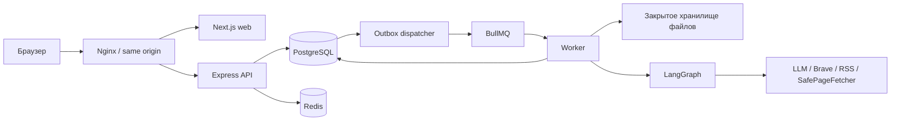

# Архитектура

PostgreSQL — источник истины. Сессии и одноразовые токены хранятся как SHA-256 hashes от случайных 256-битных значений; пароли — Argon2id. CSRF привязан к сессии, включая гостевую сессию до регистрации/входа. Проверяется Origin.

Membership связывает пользователя с организацией, ролью и доступными направлениями. Общие сведения организации доступны всем участникам. Закрытые документы и overrides принадлежат направлению. Все операции и worker проверяют актуальное членство. UUID не является разрешением.

API создаёт InsightRun и Outbox одной транзакцией с advisory lock. Частичные unique indexes страхуют конкурентные active runs. Диспетчер доставляет job ID в BullMQ; повторная доставка не публикует второй набор revisions. Публикация и cursor выполняются транзакционно с проверкой версии cursor.

Графы анализа, конкурентов и чата используют PostgreSQL checkpointer. Технические узлы не вызывают модель без необходимости. Граф анализа разделяет планирование, retrieval, извлечение, кластеризацию, оценку, проверку и уточнение. Авторизация, лимиты и идентификаторы передаются доверенным сервером, вне LLM JSON.

Внешние документы и новости недоверенны. Инструкции в них не определяют доступ и инструменты. В поисковые запросы уходят явно настроенные публичные темы, домены конкурентов или выбранные по локальному словарю отраслевые темы. Приватный текст профиля и документов может использоваться настроенным LLM; это раскрывается в настройках источников.

SafePageFetcher проверяет каждый redirect и все DNS-адреса, фиксирует выбранный публичный IP для соединения, ограничивает время и размер. HTML не исполняется. HTTP 401/403 и paywall не обходятся. Сжатые ответы, несмотря на `Accept-Encoding: identity`, отклоняются.

SSE читает сохранённые события с монотонным ID. Reconnect и polling не создают задания. Финальный текст хранится в таблицах приложения. Удаление документа убирает chunks и checkpoints; история сохраняется, но не служит основанием для нового ответа при утрате источника.
