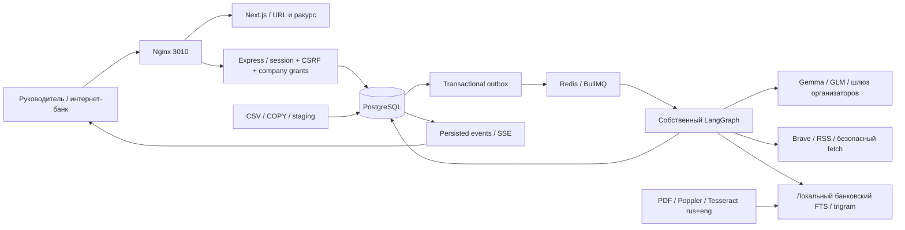

# Корпоративный контур Альфа-Бизнеса

Главная ветка и её volumes не используются. Контур имеет собственные image, сеть, PostgreSQL, Redis, files и cookie `context_alfa_session`. Проект Compose называется `context-alfa-hackathon`; вход только через loopback 3010. Авторизация интернет-банка моделируется существующим защищённым локальным аккаунтом.

## Данные и происхождение

`DatasetImport` фиксирует SHA-256, настройки единиц и качество. CSV разбирается потоково с BOM, разделителем `;`, кавычками и многострочными полями. COPY поступает в транзакционный staging; нормализация выполняется SQL. Повтор SHA возвращает существующий импорт. Конфликтующие признаки исключаются из `CorporateCompany.fields`, все варианты остаются в `CompanyVariant`. Неизвестные контрагенты — отдельные узлы без выдуманных характеристик. Денежные суммы — Decimal, число платежей — BigInt; API отдаёт их строками.

`PersonCompanyLink` не доказывает собственность. `PaymentEdge` содержит только доступный срез: концентрация вычисляется отдельно по входящим/исходящим связям, self-links исключены. Валюта и период неизвестны. Положение и доля выручки относятся к предоставленному набору, а не к рынку. GROUP_ID объединяет данные, не права.

`CorporateCompany` связан с направлением; `CompanyGrant` предоставляет явный доступ пользователю независимо от C-level ракурса. Проверяется также membership. Ручные уточнения лежат отдельно в `_overrides`, сохраняют автора/дату, создают immutable `ProfileVersion` и увеличивают версию. Запуск фиксирует полный snapshot контекста и не публикует результат поверх изменённой версии.

`BankMaterial` сохраняет PDF, hash и проверенную дату. `BankPage` содержит неизменяемый текст, страницу, метод, confidence и координаты слов. OCR не используется для подтверждения чисел без ручной сверки. Для золота известен месяц, день неизвестен. Документ 2021 года явно исторический. Корпус индексируется локально; исходные PDF/CSV в Git не попадают.

`CorporateNews` — сохранённая версия материала по SHA. `CorporateInsight` связывает компанию, запуск, новость, версию контекста и evidence. В DTO раздельны внешнее событие, признаки клиента, банковская цитата и выводы AI. Проверяется точное присутствие цитаты в сохранённом тексте/странице; нормализация меняет только Unicode/пробелы. Банковский раздел интерфейса отображает точную цитату; свободный текст AI не выводится как банковская позиция.

## Граф и ограничения

Контекст → план → retrieval → Gemma extraction → clustering → GLM interpretation → программная и GLM-проверка → до двух уточнений → транзакционная публикация. Публичные запросы составляются из закрытого словаря отраслей/тем, не из ID, сумм или связей. Модель не может добавить инструмент. Уточнение меняет запросы/контекст, успешные извлечения и оценки переиспользуются.

Demo проходит тот же граф с детерминированными узлами. Live запрещён без разрешённого model ID, отдельного ключа и тарифа. Новостной cursor личного продукта не меняется. Собственная логика без готового автономного агента. `CorporateTrace` хранит инструменты, версии, признаки, проверяемые результаты, модель и usage; внутренние рассуждения модели не сохраняются.

Дневной ledger `DailyBudget`/`BudgetReservation` общий для пользователей/worker одной БД и ключа. До HTTP резервируется консервативная верхняя оценка входа и max output, BigInt в нанорублях. Резервы сериализуются advisory lock. Usage сверяется; неизвестный исход сохраняет резерв до ручной сверки. Постоянные ошибки не повторяются, временные — максимум дважды с отдельным резервом. Модель/тариф проверяются до HTTP; несовместимая схема даёт явную ошибку.

Outbox, BullMQ и PostgresSaver обеспечивают повторную доставку/resume. Публикация идемпотентна по company/news/contextVersion; транзакция повторно проверяет grant и статус. Отмена/отзыв доступа удаляют checkpoint. Приватный чат получает текущий ракурс; семь ответов заранее не генерируются. Административный OCR выполняется worker через тот же outbox, без платного AI.

## Производительность и границы

`CorporateInsightRevision` хранит неизменяемые оценки. Ключ анализа включает версию алгоритма, режим, IDs моделей, версии/даты банковских материалов и состояние проверки OCR-чисел. Новый корпус или модель позволяют повторно рассмотреть прежнюю новость; неизменённый ключ использует опубликованную оценку. Публикация и latest pointer атомарны, повтор delivery не создаёт ревизию. Миграция переносит старые оценки в legacy-ревизии без выдумывания прошлых банковских снимков. История доступна по прямому URL `?revision=...`. Cursor ленты фиксирует `asOf` и читает последнюю ревизию на этот момент, поэтому обновление рейтинга не теряет элементы между страницами.

Лента ранжируется одним SQL с ролью/интересами и стабильным tuple cursor до LIMIT; на карточки нет отдельных запросов. Истории имеют временной cursor. Индексы: компании/выручка, endpoints платежей, группы, FTS/trigram страниц, компания/дата инсайдов. Все платёжные строки LLM не получает. SSE работает только для активной задачи, polling — при обрыве до завершения.

Семантическое объединение пересказов и обоснованность живых рекомендаций требуют измерения с организаторскими моделями. Детерминированный дедупликатор консервативен: нормализует одинаковые тексты и не объединяет события по общему слову. Размеченный набор и ограничения — в отчёте качества; это не замена экспертной AI-приёмке.
