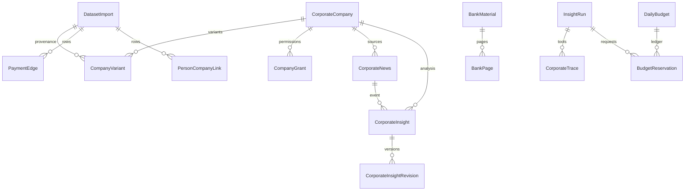

# Модель данных и словарь CSV

[Документация](README.md) · [Prisma schema](../packages/db/prisma/schema.prisma) · [DTO](../packages/contracts/src/corporate.ts)

## Сущности

Диаграмма показывает логические связи, включая provenance по ID. Не каждая линия объявлена ORM foreign key: ограничения также заданы SQL-миграциями и транзакционным кодом.

| Группа     | Сущности и назначение                                                                                                                  |
| ---------- | -------------------------------------------------------------------------------------------------------------------------------------- |
| Импорт     | `DatasetImport`: SHA/settings/quality; `CompanyVariant`: все исходные варианты с номером строки                                        |
| Контекст   | `CorporateCompany`: нормализованные признаки/conflicts/version; `PersonCompanyLink`: обезличенная связь; `PaymentEdge`: платёжный срез |
| Доступ     | `CompanyGrant` + `Membership`: явная компания и scope; профессиональная роль отдельно от `canEdit`                                     |
| Корпус     | `BankMaterial`: оригинал/hash/дата/coverage; `BankPage`: текст/страница/метод/boxes/качество/проверка чисел                            |
| Аналитика  | `CorporateNews`, `CorporateInsight`, immutable `CorporateInsightRevision`; `analysisKey` фиксирует алгоритм/режим/модели/корпус        |
| Работа     | `InsightRun`, outbox, persisted events, PostgreSQL checkpoints; `CorporateTrace` — наблюдаемые этапы                                   |
| Обсуждение | `CorporateChat` принадлежит пользователю; `CorporateFeedback` хранит вердикт и экспертную заметку                                      |
| Расходы    | `DailyBudget`, `BudgetReservation`: окно ключа, резерв, settlement и usage; actual ₽ может быть `null`                                 |

Ручные уточнения в `_overrides` сохраняют автора/дату, создают `ProfileVersion`, увеличивают версию. Исходные строки не переписываются. Публикация повторно сверяет версию контекста и права. Новые корпоративные исследования не двигают cursor личного новостного анализа.

## Все поля приложения 1 · юридические лица

| Поле                             | Смысл источника и ограничения                                                                    |
| -------------------------------- | ------------------------------------------------------------------------------------------------ |
| `SYNTHETIC_U`                    | Обезличенный ID компании, не внешний реестр/ИНН                                                  |
| `ORG_TYPE`                       | Тип организации                                                                                  |
| `OKFS_NAME`                      | Форма собственности                                                                              |
| `COMPANY_AGE_YEARS_GRADATION`    | Возрастная градация, не точная дата регистрации                                                  |
| `ECO_MARK_LABEL`                 | Стадия бизнеса из набора; не стартапный onboarding личного продукта                              |
| `MAINOKVED_CODE`                 | Основной ОКВЭД                                                                                   |
| `MAINOKVED_NAME`                 | Основной вид деятельности                                                                        |
| `NEGATIVEMARK`                   | Признак ключевого собственника по описанию кейса; не кредитный риск и не доказательство контроля |
| `AMOUNT_WORKERS_FNS_GRADATION`   | Градация работников по ФНС                                                                       |
| `AMOUNT_WORKERS_SPARK_GRADATION` | Градация работников по СПАРК; пропуск не означает ноль                                           |
| `CL_TYPE`                        | Клиентский статус: действующий/потенциальный                                                     |
| `CL_PRODUCT_RKO_MARK`            | Отметка РКО                                                                                      |
| `CL_PRODUCT_GAR_MARK`            | Отметка банковских гарантий                                                                      |
| `CL_PRODUCT_LOA_MARK`            | Отметка кредитных продуктов; не кредитный рейтинг, не сумма и не ставка                          |
| `CL_PRODUCT_LEA_MARK`            | Отметка лизинга                                                                                  |
| `CL_PRODUCT_DEP_MARK`            | Отметка депозитов                                                                                |
| `CL_PRODUCT_ZPP_MARK`            | Отметка зарплатного проекта                                                                      |
| `FTS_FLAG`                       | Наличие сведений в базе ФТС; не ФНС/госзакупки и не доказательство валютной позиции              |
| `FTS_COUNTRY_NAME`               | Страна из данных ФТС; направление/валюту торговли не устанавливает                               |
| `FACTORING_MARK`                 | Отметка факторинга                                                                               |
| `REVENUE_COMPANY`                | Годовая выручка в единицах исходника; рубли без подтверждённой настройки не выводятся            |
| `GROUP_ID`                       | Группа по источнику; не право доступа и не консолидированная отчётность                          |
| `CITY`, `REGION`                 | Место регистрации; не доказательство географии операций                                          |

Нулевой продуктовый флаг означает отсутствие отметки в наборе, а не доказанное отсутствие всех соответствующих договоров. Словарь явно передаётся LLM. Конфликтующие поля до подтверждения не включаются в автоматические факты.

## Физические лица и платежи

| CSV                        | Поля                                                 | Правила                                                                                             |
| -------------------------- | ---------------------------------------------------- | --------------------------------------------------------------------------------------------------- |
| `df_Fid_Uid_link_hack.csv` | `SYNTHETIC_F`, `CITY_NAME`, `RC_NAME`, `SYNTHETIC_U` | ID связанного лица, место проживания, компания. Совпадение лица — связь, не доказательство владения |
| `df_Uid_payment_hack.csv`  | `PAYER`, `BENEFICIARY`, `PAY_AMT`, `PAY_CNT`         | Отправитель/получатель, объём и количество; неизвестный контрагент остаётся unknown-узлом           |

`PAY_AMT` — Decimal(38,6), `PAY_CNT` — BigInt. Нормализованная выручка — Decimal(30,6). В JSON суммы/счётчики передаются строками, без потери точности через JavaScript Number.

## Расчёты и происхождение

- Концентрация — доля суммы **доступных** входящих/исходящих связей отдельно; self-links исключены. Валюта и период не известны, влияние на операции — гипотеза.
- Позиция по выручке и её доля относятся к предоставленному датасету. `realMarketShare=null`; сумма компаний группы не называется консолидированной выручкой.
- Evidence содержит `kind`, `sourceId`, `quote`, `row`/`field` или `page`, дату, confidence и historical. Виды: news/bank/csv/calculation/synthetic/user.
- `CorporateInsightRevision` не изменяется. Пагинация ленты фиксирует `asOf`; обновление latest pointer не должно терять записи между страницами.

[Фактические количества, пропуски и конфликт ID](hackathon-data-quality.md) · [Источники, SHA и OCR](hackathon-sources.md).
