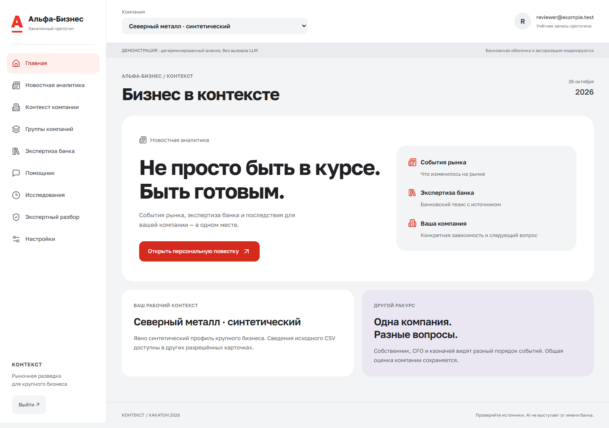
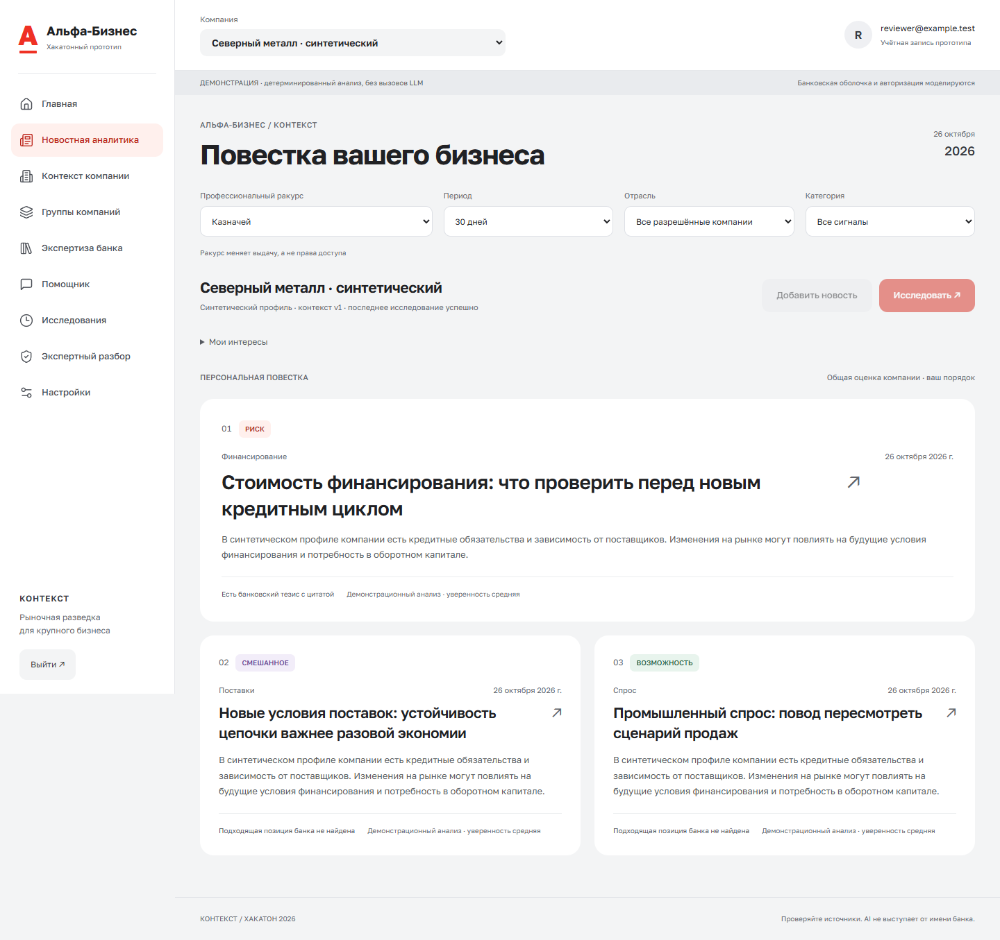
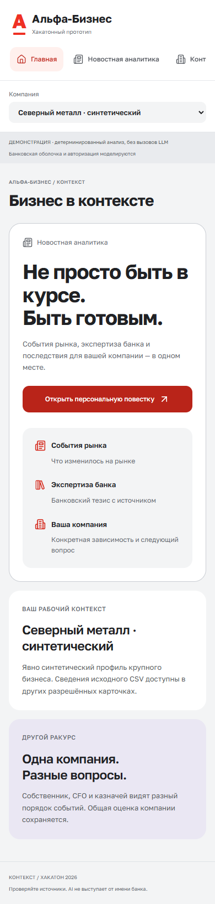
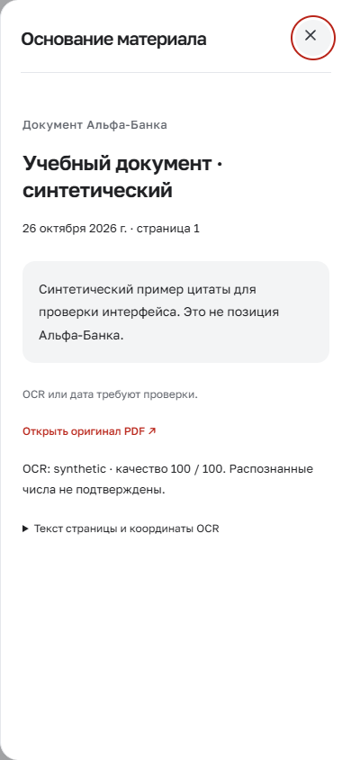

# Оформление Альфа-Бизнеса

[Документация](README.md) · [Матрица требований](hackathon-compliance.md) · [Приёмка](hackathon-acceptance.md)

## Ориентир и границы

26.10.2026 интерфейс сопоставлен с публичной [презентацией цифрового банка Альфа-Бизнес](https://alfabank.ru/sme/digital-bank/) и [страницей интернет-банка](https://alfabank.ru/sme/rko/internet-bank/). Визуально проверены светлая композиция, крупная типографика, скруглённые поверхности, красные действия и спокойные формы. Закрытый личный кабинет банка не исследовался; точное совпадение с авторизованным интернет-банком не заявляется.

Это моделируемая интеграция для хакатона. На входе и в рабочей области постоянно указано, что приложение — прототип. Оно использует свою авторизацию и не выполняет банковские операции. Исходный смысл аналитики, права, данные и конфигурация live не менялись.

## Что изменено

| Элемент           | Реализация                                                                                                           |
| ----------------- | -------------------------------------------------------------------------------------------------------------------- |
| Оболочка          | Светло-серый фон `#F3F4F5`, белая навигация и поверхности, разделители `#E5E7EB`                                     |
| Бренд и действия  | Красный знак, активный пункт с мягкой красной подложкой, контрастные красные кнопки                                  |
| Геометрия         | Панели 20–28 px, кнопки 12 px, формы 10 px; вместо острых журнальных рамок                                           |
| Типографика       | Локальный Golos Text, заголовки 28–50 px, основной читаемый текст 13–16 px                                           |
| Главная           | Постоянный заметный вход «Новостная аналитика», пояснение цепочки событие → банк → компания                          |
| Лента             | Ведущий материал на всю ширину, остальные в две колонки; на телефоне одна колонка                                    |
| Источник и инсайт | Белая страница чтения, выделенный банковский фрагмент, боковая панель с датой и происхождением                       |
| Остальные экраны  | Единый стиль входа, контекста, групп, корпуса, чата, истории, экспертного разбора и настроек                         |
| Мобильный экран   | Компания и формы по ширине экрана, отдельная прокрутка меню, без горизонтального переполнения страницы               |
| Доступность       | Focus-visible, возврат фокуса после закрытия диалога, Escape/Enter, reduced motion для страницы и портальных панелей |

Иконки — существующий Lucide. Фирменный шрифт Alfa Interface Sans не включался: используется лицензированный локальный Golos Text. Новых изображений или сторонних шрифтов не добавлено.

## Цветовой контраст

Расчёт по относительной яркости sRGB, для обычного текста требуется не менее 4,5:1:

| Пара                                 | Контраст |
| ------------------------------------ | -------- |
| Белый текст / кнопка `#D52B1E`       | 5,01:1   |
| `#62666D` / фон `#F3F4F5`            | 5,24:1   |
| Активный пункт `#BD251B` / `#FFF0ED` | 5,50:1   |

Основной красный `#EF3124` оставлен для знака и декоративных акцентов; мелкий текст и кнопки используют более тёмные контрастные варианты. Контраст этих пар не является заявлением о полном аудите WCAG всего приложения.

## Проверка без Docker и ключей

```sh
pnpm hackathon:ui:preview
```

Открыть `http://127.0.0.1:3012`. Локальный API на `127.0.0.1:4012` отдаёт только явно синтетические UI fixtures, проверенные общими Zod-схемами. Подключений к БД, CSV/PDF пользователя, провайдерам или `.env` нет. Кроме входа в локальную демонстрацию, изменения отклоняются с HTTP 405. Это визуальный стенд, не полноценный demo-граф и не замена live-приложения на 3010.

Автоматическая проверка в PowerShell (сама запускает и останавливает стенд):

```powershell
$env:BANK_UI_PREVIEW='1'
$env:PLAYWRIGHT_CHANNEL='msedge'
pnpm exec playwright test tests/e2e/bank-design.spec.ts
```

**Результат 26.10.2026: 3/3**, Edge, 1440×1000, 1024×900 и 390×844. В каждом сценарии проверены вход, главная, лента, ракурс, отдельный инсайт, банковская панель, контекст, группы, материалы, чат, история, экспертный разбор, настройки, reload, Enter/Escape, возврат фокуса и reduced motion. Скриншоты всех экранов сохраняются в игнорируемом `test-results/`. Избранные копии ниже опубликованы без редактирования изображения.

Проверка нашла и устранила наследуемый reset скруглений форм, старый фон источника, анимацию портала при reduced motion и потерю фокуса у управляемых Radix-диалогов без Trigger.

## Снимки интерфейса

Все данные и цитаты на этих снимках синтетические; учебная цитата прямо обозначена как не являющаяся позицией банка.







## Граница приёмки

На финальном коде прошли `pnpm build` (включает typecheck), `pnpm lint`, **82/82 unit**, **3/3 UI E2E**, `pnpm docs:check` (29 Markdown-файлов, 195 локальных ссылок) и сканирование секретов. `git diff --check` не обнаружил ошибок пробелов. Избранные desktop/mobile скриншоты просмотрены визуально; для сохранения стабильного кадра Playwright завершает анимации перед снимком.

Typecheck, lint и production build выполняются отдельно от UI-стенда. Docker Engine в этой сессии недоступен; новый Compose-запуск, повторная интеграционная проверка БД и платный live-анализ для редизайна не выполнялись. Исторические результаты 24–25 октября сохранены в [протоколе приёмки](hackathon-acceptance.md). Обновление работающего контейнерного экземпляра требует доступного Engine и обычной пересборки хакатонного Compose; volumes и `.env` сохраняются.
